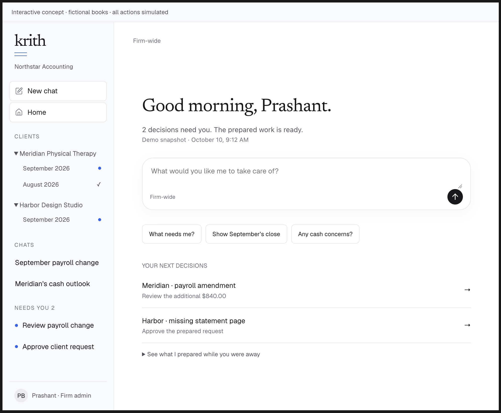

# Agent-first product fixes and accuracy handoff

Original handoff: **2026-10-10**. Demo execution priorities: **2026-10-14**, reconciled with implementation on **2026-10-15**, below. Delivery and validation remain separately recorded in the backlog and validation history.

## Start here

Implement the product and accuracy improvements below within the current Krith experience. Preserve the chat-first Home, compact sidebar, existing Clients → company/client → monthly closes → close-with-tabs navigation, close pages and supporting tabs. Do not copy the demo's expanded company/month tree into the sidebar. The agent prepares and coordinates the work; the person supervises, resolves real uncertainty, approves, rejects or improves a proposal. An agent must not replace this experience with a different dashboard or make the accountant orchestrate ordinary preparation.

Read in order:

1. [Repository instructions](../AGENTS.md).
2. [Governing build plan](agent-first-build-plan.md), including its [supervision experience contract](agent-first-build-plan.md#supervision-experience-contract).
3. This handoff for concrete fixes and acceptance scenarios.
4. [Design system](design-system.md) and the relevant feature documents linked below.
5. [Delivery backlog](implementation-backlog.md) and [validation history](validation.md) for current implementation and evidence.

**Authority:** the build plan owns B01–B12, phases A–E and launch gates. This document translates the October 10 review and founder decisions into implementation work; it does not replace the plan or create a competing launch backlog. Keep all B01–B12 requirements, including reports, budget comparison and cash decisions. Track delivery in the existing backlog using those package IDs. Optional extensions below require an explicit scope decision before becoming launch requirements.

## Demo readiness execution update

**October 14, 2026; source baseline `05807121` / PR #499.** These priorities refine the existing slices against that implementation. The product gaps below are established by source inspection, not a new browser reproduction. Recheck them on the implementation branch; older instructions do not mean their fixes are still missing.

**October 15 delivery reconciliation, `51eb2c48`:** PRs #500–#504 implement the five planned core changes: one request flow (#500), partial-reply continuation (#501), correction clarification/relevant evidence (#502), separate evaluation gates (#503), and request attention/refresh/error states (#504). Their local checks are recorded in [validation history](validation.md). The behavior requirements below remain acceptance criteria, not instructions to rebuild those fixes. Live-model and connected acceptance are still outstanding. Decision visibility also remains short of the five-second target: proposal polling is 15 seconds, and the recorded local Home check observed the decision within 10 seconds.

**October 17 visibility follow-up:** the existing attention stream checks every three seconds; active close decisions, goal status and proposed/approved requests poll every three seconds. The shared version also covers muted/read/snoozed decisions, so notification preferences cannot suppress Home refresh. Local synthetic browser checks observed Home and Requests update in about 2.8 seconds without a manual refresh, and preserved wording during request polling. See [validation](validation.md). The request-read recovery follow-up exposes Retry on initial/cached failures, preserves wording and recipient edits, and blocks approval until refresh succeeds; local recovery checks pass. Hosted timing and connected acceptance remain open.

**Outcome:** after one scoped mandate, the agent progresses supported accounting work; the person supplies judgment and consequential approval. An answer, released document or approval continues its permitted dependencies without another instruction. Home, chat and the close show the same current decision. A backend change is unfinished until its visible continuation and recovery work.

Preserve the current shell and the governing B01–B12 scope, including reports, budgets and cash decisions. This is an execution specification, not authorization for live sends, posting or partner access. New vertical connectors, messaging channels, ledgers, dashboards and orchestration infrastructure are outside this demo effort.

### Current status

| Classification | Current position | Next action |
| --- | --- | --- |
| Built foundations | Goals, preparation queues, methods, source-linked review, consolidated proposals, private replies, quarantine, recurring work, reports/budgets, publication, executive briefing and cash-buffer versioning exist. | Reuse and connect their existing records, handlers and UI. |
| Product changes delivered | PRs #500/#501/#502/#504 address the four gaps identified at `05807121`; scoped local checks are recorded. The October 17 follow-up closes the reproduced local visibility timing gap. | Verify hosted timing, then execute the connected acceptance below. Fix other deficiencies only when reproduced. |
| Validation tooling delivered | PR #503 makes incomplete correction outcomes fail task completion separately from safety and updates the evidence summary. | Run both gates against the configured live model; a local scoring test is not a model result. |
| Missing validation | Actual-model/provider behavior, connected browser execution, independently checked demo outcomes, unfamiliar reviewers and recovery need candidate-revision evidence. | Run the existing tools and journeys; dependencies and unrun cases stay unverified. |

### P0 product lane

The four acceptance contracts below block the proposed agent-first demo until satisfied; their core implementations are delivered as recorded above. Request unification precedes dependency resumption because approved questions must retain their work associations. Decision visibility completes each continuation; it is not later cosmetic polish.

1. **One request through every entry point — B02/B05/B06; core delivered in #500.** [Chat](../services/backend/internal/transport/chat.go), goal cards and Requests use existing [request proposals](../services/backend/internal/transport/request_proposals.go). At the review baseline, older question generation included blockers and reviewer notes in proposed client wording; #500 removes that automatic path. Approval was required: the finding was a disclosure risk in a proposal, not an observed automatic send. Preserve editing, recipient/sender approval and freshness checks.

   **Done:** every entry point opens the same current proposal; firm-only judgment stays internal; repeated actions cannot create competing requests/sends; a stale card requires review of the changed effect.

2. **Partial answers resume their own work — B04/B05/B11; core delivered in #501.** [Client replies](../services/backend/internal/transport/client_requests.go) and [attachment release](../services/backend/internal/transport/attachments.go) use shared [request resumption](../services/backend/internal/preparation/requests.go). Preserve approved question identities and their work associations when wording changes. Resume only when a dependency has all required answers and usable evidence, with applicable identity, scanning, release, permission and freshness checks. Older requests without question-to-job associations retain complete-request resumption; do not claim granular continuation for those records.

   **Done:** an insurance answer resumes insurance while the bank question remains open; a job needing two answers waits for both. Quarantine still blocks dependent use; duplicate replies/releases do not duplicate preparation. The person sees what resumed and what remains, without copying answers or pressing Resume.

3. **Clarification continues the original correction — B04/B06; core delivered in #502.** [Revisions](../services/backend/internal/transport/revisions.go) retain a pending clarification against its return and current draft/source versions; an answer or newly usable evidence resumes it. Keep deterministic recalculation, fresh review and the bounded shortlist, now selected by newly available evidence and relevance rather than recency alone. Ask for a specific document choice if relevance is unresolved. Keep the supported prepaid/accrual correction boundary explicit.

   **Done:** return a prepaid with an ambiguous service date, then answer or supply its contract: the same correction produces a revised draft without a second Return. An older relevant contract behind more than eight newer documents remains discoverable. Show before/after values, calculation, source and uncertainty. A one-off correction does not activate future policy; revoked access or a superseded draft prevents stale execution.

4. **Decisions appear where the person is — B02/B05/B06; core delivered in #504, timing acceptance open.** Unapproved proposals join existing [attention](../services/backend/internal/transport/attention.go); [Requests](../apps/frontend/src/features/closes/RequestsTab.tsx) and [ProposedRequest](../apps/frontend/src/features/closes/ProposedRequest.tsx) refresh them and show errors. Resolve the remaining five-second visibility target through existing refresh mechanisms; no new push service is required. Check Retry and edit/scope preservation on recoverable failures in the browser.

   **Done:** an already-open Home shows a background-prepared request without refresh, opens the exact proposal and clears its decision after approval. Other views agree and old cards show completed/superseded status. Completion receipts do not inflate approval counts; a read failure does not become zero work. Measure confirmed state changes against the governing five-second online visibility target, separately from model execution time.

### P0 evidence lane

**The scoring fix is delivered in #503; live execution is pending.** Use the existing [revision evaluator](../services/backend/cmd/revision-eval/main.go) and [evidence runner](../scripts/evidence-run.sh); keep expected outcomes fixed before execution. Expected corrections must produce the complete correct change and calculate successfully. Required clarification cases must remain safely unresolved. Unnecessary questions, incomplete changes, calculation refusals, errors and unrun required cases cannot produce an acceptance pass. Report safety and completion separately.

The direct evaluator does not prove the application lifecycle: also exercise return → clarification → answer/evidence → worker → revision → review. For every demonstrated work type, check whether the corpus scores the resulting draft/entries or just extracted facts. Fill only the demonstrated coverage gaps in the existing harness, and independently check their expected accounting results. Evaluation output supports diligence; a passing small fixture is neither a universal safety percentage nor a demonstrated moat.

### P1 connected outcome and execution

**Owners:** engineering prepares fixtures, fixes and execution records; the founder arranges access and an independent accountant; the accountant confirms expected treatments and demonstrated results. Fixture/access preparation proceeds alongside P0. Size the work and confirm dependencies before promising dates.

**Current execution order:** retain the five delivered changes, resolve the remaining visibility timing target and prepare access/fixtures. Run the configured live-model gates and connected browser checks, then accountant review and both rehearsals; complete all P0 acceptance before the confident demo. Fix any reproduced continuation failure at its shared boundary. No backend-only merge or green evaluator substitutes for the journey checks.

Reuse the [seed](seed-data.md). It uses recorded model answers and deliberately leaves the prepaid method unapproved: establish the procedure once through the existing reviewed-method flow. Prepare one synthetic company with an active month, a completed reviewed period and a next-period continuation. Include two independent questions, an ambiguous correction, an older contract, a late amendment and a cash scenario.

Before locking the fixture, inventory the period's expected accounts and work with the accountant. Verify that takeover proposes available scope/mappings/methods and asks only for unresolved choices once. Include the supported bank/card, payroll and schedule work relevant to that company; label manual and unsupported paths. If ordinary supported work still needs repetitive fact entry or manual coordination, record a B01/B04 product gap and resolve it before claiming the person mostly approves. Do not obtain a clean demo by omitting an obligation or preparing the work invisibly outside the product.

Execute the baseline through the actual configured model and ordinary product routes before the pitch. Retain revision, model/settings, source versions, results, timings and assistance receipts. Reset with existing setup paths; preserve valid lineage and rerun affected work when versions change. Do not build a snapshot subsystem or relabel recorded answers as live output.

Verify the connected business result: statements and budget comparisons agree with the published export; the executive sees only permitted client information; cash states its dates, assumptions, readiness and agreed buffer. Proposed or unverified ledger adjustments cannot appear as posted actuals. Traceability follows the actual calculation/report/ledger path; do not promise an underlying invoice for every report figure when that evidence is absent.

Use normal authenticated reviewer/executive accounts, the executive limited to one synthetic client. Check UI, direct URL, API and chat access. Development and automated checks use local PostgreSQL; never create a Neon branch. Capture delivery locally unless a controlled live recipient is separately approved. Verify each actual provider operation shown; synthetic QBO-shaped books do not prove QBO connectivity or posting.

### Experience measures and acceptance

Fix the workload and expected work before running it. Record these measures in existing validation/evaluation outputs; no new analytics platform is required.

| Measure | Acceptance for the defined demo workload |
| --- | --- |
| Correctness and authority | Zero observed critical wrong amounts/treatments, missed material obligations, false-ready states, cross-client disclosures or unauthorized/duplicate effects; report attempted cases and failures. |
| Useful completion and coverage | Report correct completions against all expected completable cases, plus eligible/unsupported/waiting counts across the entire agreed workload. Explain uncovered items; do not improve results by removing difficult work from the denominator. |
| Human coordination | Zero extra prompts or manual restart/refresh/re-return actions for delegated continuations. Count initial mandate, genuine clarification, required release and consequential approvals separately; these necessary decisions are not defects. |
| Decision quality | An unfamiliar reviewer identifies client/month, reason, recommendation, financial effect, evidence, uncertainty and exact authority without reconstructing work across tabs. Preserve keyboard/mobile use and recoverable edits. |
| Persistence | Closing the browser, opening a fresh chat and interrupting the worker preserve mandate, current decisions and completed work without engineer repair. Month two reuses methods only within approved bounds. |
| Latency | Record acknowledgement, model/provider work and persisted-change-to-visible-state times separately. Show last completed step and next action, without invented progress percentages or ETAs. Retain existing route targets and the five-second online visibility target. |
| Total human effort | Count preparation, chasing, review, corrections, off-platform work and builder help; report setup separately. A short demo or faster review does not establish total savings. The governing 40% median-effort gate requires its baseline evaluation before partner access. |

### Rehearsal and customer presentation

Keep the full chronological [connected walkthrough](#required-connected-acceptance-walkthrough). Run it from reset data and again with an interruption/retry. Include an unfamiliar qualified reviewer acting without builder directions. Preserve interventions, retries, failed cases and source/model receipts. All required demo cases must run within the existing daily model-call ceiling; a limit or dependency is not a pass.

Present the result first within the governing eight-to-ten-minute customer narrative:

1. **Prepared work and business result.** Open Home's remaining decisions, then the completed period's reviewed report and executive cash briefing. Label prior live execution and distinguish reviewed actuals from forecasts; approved assumptions do not verify a future cash outcome.
2. **Partial continuation live.** In the active month answer insurance alone; show it continue while the bank question stays open. Complete remaining evidence through its normal checks.
3. **Correction live.** Return the prepaid, answer its clarification and inspect the recalculated difference. Show the judgment followed by automatic continuation.
4. **Late change and next month.** Introduce a source revision; affected approvals/publication status change while unrelated approvals survive. Show persisted next-month work. Label any prior run or time transition used for slow work and retain its actual receipts.

Choose live transitions from measured rehearsal timings, not an assumed model latency. During slow work, show durable progress and already completed evidence. On failure, show the real state or identify a labelled recorded fallback; never call a replay live. Presentation order does not replace chronological acceptance.

### Demo go and partner access gates

Engineering assembles candidate-revision evidence for focused regressions, actual-model outcomes, browser/access checks, independently checked accounting outputs and both rehearsals. The accountant confirms demonstrated treatments/results; the founder checks pitch claims against that record. **The confident agent-first demo is no-go if a P0 remains, a required case is unrun, a critical failure is unresolved, a journey needs hidden builder repair or the reviewer cannot act unaided.** A narrower work-in-progress preview must not be described as passing this gate.

A passing synthetic demo establishes behavior on that workload. Partner-operated access still requires all governing B01–B12 gates: independently reviewed enabled methods, varied authorized records and held-out cases, at least three varied eligible clients across two periods, the broader corpus, measured total-effort savings, offered-provider acceptance and hosted security/recovery. New presentation, code paths and model endorsement do not establish commercial confidence or pricing power.

Record delivery in the existing [backlog](implementation-backlog.md) and proof in [validation](validation.md). Extend the nearest existing tests for changed behavior; observe any new regression fail without its fix. Use the main path and at most one key failure path, with no new test framework or broad default checks. Run affected packages/direct consumers and obtain the one final other-model review required by AGENTS before committing the completed change set.

## Evidence and review boundaries

The reviewed source revision was `bcb5c17157598e8ee4d791324176d42b10a2235e` (PR #349). Recheck current source before editing; symbols below are entry points, not instructions to rebuild already-completed work.

| Classification | What was established | Implementation implication |
| --- | --- | --- |
| Reproduced defect | The chat citation support gate accepted a net-income assertion supported only by an equal-valued receivables field. | Add a failing regression and correct financial claim binding. No live-model error frequency was measured. |
| Source-verified limitation | The straight-through document path is limited to eligible prepaids; other supporting/unselected non-machine documents can stop this path. Separate carry-forward/standing-authority paths exist. | Expand evidence relationships and required methods safely; retain contradiction checks. |
| Source-review risk | Cash obligations can be suppressed by a bill for the same vendor/week without a specific obligation association. | Reproduce the cases below before selecting the smallest correct fix. This was not reproduced through the API. |
| Design observation | Overview, Books, Workpapers, Requests and Cash plan were inspected in the founder's linked prototype. Generic tasks, duplicate summaries, ambiguous counts and an overconfident forecast headline were visible. | Treat these as design corrections to reconcile with current implementation, not proof of production behavior. |
| Evidence gap | A complete dated release record for actual models/providers, independent accounting outcomes and hosted recovery was not found in the review. | Assemble and run acceptance; do not conclude that every live service is broken. |

Design reference: [A close, every tab](https://claude.ai/artifact/9kJ14xr1tot7UiGqwvGXVD#play-8bcb752393f9). The initially inspected Overview is the agent-working variant. The functional review detail could not be established from its Review button. A later October 10 inspection covered [Settings for this client](https://claude.ai/artifact/9kJ14xr1tot7UiGqwvGXVD#play-defebb575c72); its additional findings appear below. The artifact can change at the same URL: reconcile earlier observations with the latest version rather than assume every old design issue remains. Documents, Reports and Sign-off recommendations follow the governing plan; their individual prototype pages were not inspected in these passes. This document preserves the required behavior so execution does not depend on the external link remaining accessible.

Prior review evidence: 142 migrations applied locally; 30 selected existing test functions passed; a separate adversarial probe reproduced the citation defect; workspace checks passed; the seed completed and Home/one changed close were inspected. These were targeted checks, not full release acceptance. See [the dated maturity review](maturity.md#product-maturity-and-differentiation-review-2026-10-10) for limits and environment details. The earlier interactive conversation demo used fictional data and simulated actions; it is not implementation evidence.

## Non-negotiable product and implementation constraints

- Use current Krith tokens, typography, components, shell, composer and client/month layouts. Keep close pages as stable views of work and evidence. Routine review can finish from chat or Overview without visiting every tab.
- Reuse the existing durable workflow engine, close goals, preparation queues, scoped domain records and API/MCP handlers. Do not create a second scheduler, generic planner, parallel decision store or second financial truth.
- Automatically progress already-delegated internal work, including eligible fact verification, calculation, draft preparation and continuation after a reply. New mandates require a scoped preview. Every field and internal step must not become a new human confirmation.
- Retain explicit authority for messages/reminders, connected-system writes, publication and sign-off. Existing standing approvals apply only within their recorded bounds. Review of a workpaper is not posting approval; a sent message is not a resolved accounting issue.
- Models interpret and propose; exact accounting calculations, state, permissions and verified effects remain deterministic. Do not achieve fewer questions by suppressing uncertainty or guessing missing facts.
- Preserve entity, month, currency, basis, source/method/mapping revisions and access scope across chat, pages, exports and workers. An executive cannot acquire accountant authority through a conversational instruction.
- Build now without waiting for a full-time accounting lead. Prepare sourced treatment specifications and independently calculated expected results; obtain focused qualified review before claiming accountant acceptance. Agreement among models is not professional acceptance.
- All database development and checks use local PostgreSQL (`docker compose up -d postgres` or disposable native PostgreSQL). Set local `DATABASE_URL`/`TEST_DATABASE_URL`. **Never create a Neon branch.** These instructions do not authorize live sends, posting, production migrations or confidential-data transfer.

## First implementation slices

These priorities order the review follow-ups inside the canonical phases. They do not defer other required packages.

| Order | Canonical packages | Slice | Required completion evidence |
| --- | --- | --- | --- |
| 1 | B04/B07/B08/B09 | Correct financial claim support and extraction/value consistency | Wrong-metric and related negative tests fail safely; valid typed answers and exact derived figures still work. |
| 2 | B09/B10 | Resolve obligation matching; make forecast readiness truthful | Explicit association/residual scenarios pass; incomplete inputs cannot produce a reviewed-current forecast. |
| 3 | B02/B05/B06 | One current decision across chat/close; truthful counts and client-reply states | Stale-card, concurrent approval, partial-reply and cross-scope checks pass. |
| 4 | B01/B03/B04/B11 | Broader preparation from mixed evidence and automatic continuation | Supported methods complete on realistic packages, with closed browser and selective waits. |
| 5 | B06/B07/B08/B11 | Change impact, preserved approvals, publication and repeat month | Late changes before/after posting and publication affect exactly the dependent records. |
| 6 | All, especially B12 | Actual-model/provider, hosted, accounting and unaided acceptance | Dated evidence for the release revision, including recovery and measured human effort. Start fixture and instrumentation work alongside slices 1–5. |

## B04/B07/B08/B09 — Financial answers that support the actual claim

**Priority:** immediate accuracy fix. Start at [agent.go](../services/backend/internal/transport/agent.go), especially `substantiates` and `agentSupport`; extend the existing [agent evaluation set](../services/backend/acceptance/agent/README.md).

### Reproduction to turn into a regression

Supply one recorded tool read containing `{"receivables":"8000.00"}`. Submit the answer `Net income is 8,000.00.` with support `{step:"t1", sentence:0, path:"/receivables", value:"8000.00"}`. At the reviewed revision, the support gate accepts it. The fixed gate must reject this assertion. The original probe called `agentSupport` directly; it did not require a model or production credentials.

### Required behavior

- Bind a financial fact to a stable metric identity, entity, period, currency/basis, status and source revision. Reuse existing report/domain fields; avoid an unnecessary general semantic framework.
- Render critical metric labels and values from typed facts. A model may explain them, but cannot relabel receivables as income, a balance as a movement, or a scenario as actual performance.
- Derive totals, differences, ratios and scenario effects through supported exact server calculations with source lineage. Legitimate arithmetic across sources must remain possible without accepting arbitrary model arithmetic.
- Check the claim's meaning and completeness, not merely numeric overlap or a shared word. Adding more prompt instructions or another LLM judge is not sufficient enforcement for critical figures.
- Keep observed movements distinct from proposed causal explanations. Unsupported causes remain hypotheses, with any needed investigation or question explicit.
- On failed support, withhold or regenerate the unsupported assertion within existing bounds; provide verified facts or a useful limitation. Never display the incorrect sentence with a reassuring citation.

**Negative acceptance:** equal number/wrong metric; correct metric/wrong client or month; wrong currency/basis; negative versus positive; balance versus change; forecast versus actual; stale report revision; omitted unexplained variance remainder; unsupported cause. **Positive acceptance:** valid exact fact, valid source-linked sum/difference, authorized multi-period comparison, zero/negative-base budget treatment. Verify the visible answer and its exported/published equivalents where applicable.

### Extraction consistency and general accounting invariants

The earlier audit reported a value/quote mismatch. Recheck current [preparation/agent.go](../services/backend/internal/preparation/agent.go) before treating it as still open. A quote containing `1,200.00` must not establish an extracted `12000.00`. Test decimal separators, signs/parentheses, currency, units, dates and context; normalizing a matching number alone does not establish the field's meaning. Conflicting or missing evidence blocks dependent acceptance, not unrelated preparation.

Apply the build plan's exact-money, complete-population and version invariants to all changed paths. Cover partial months, leap years, rounding residuals, credits/reversals, duplicate invoices, existing posted adjustments, statement pagination and source totals. A balanced journal alone is not evidence of correct accounts, period or treatment. Preserve trial-balance/report freshness, tie-out blockers and explicit scope exclusions.

## B09/B10 — Cash matching and honest decision readiness

**Priority:** reproduce source risk and correct the user-facing forecast contract. Start at [cash_plan.go](../services/backend/internal/transport/cash_plan.go), [CashPlan.tsx](../apps/frontend/src/features/closes/CashPlan.tsx), [OpenItems.tsx](../apps/frontend/src/features/closes/OpenItems.tsx) and [cash plan documentation](cash-plan.md).

### Matching cases

The reviewed `billWeeks` matching uses vendor and due week to suppress an outgoing recurring estimate. Vendor/week alone cannot establish that a bill replaces a particular obligation.

Use explicit obligation/occurrence association or equivalently precise existing domain evidence. Preserve reviewed overrides, lineage and residuals; do not create duplicate base cash items. Ambiguous association requires one focused decision and a visible effect on the estimate.

Create independent fixtures for:

- Approved rent of $10,000 plus a separate $500 maintenance bill from the same landlord/week: the known distinct commitments total $10,500.
- A $4,000 bill explicitly invoicing part of a $10,000 commitment: represent the bill plus $6,000 residual, under the approved assumption that the total commitment remains $10,000.
- Two separate obligations for one vendor/week; only the specifically associated occurrence is replaced.
- Full replacement, duplicate capture, credit, disputed/held bill, missing date and moved payment date; preserve identity even when timing changes.
- A later source or timing change: refresh only the affected forecast, invalidate reviewed-current status and preserve the historical version.

### Forecast presentation

The prototype's reassuring cash headline coexists with a proposed $18,000 bonus based on prior-year behavior and an undated $6,420 bill. Replace that conclusion with a draft/incomplete state naming the unresolved assumptions. Prior-year behavior may suggest a proposal, not establish an approved commitment. Display excluded/unscheduled amounts and why they cannot yet be placed; do not silently assign a payment date or omit them from readiness.

Show **minimum daily projected book cash and date**, with weekly totals as supporting detail. A positive weekly closing balance cannot rule out a midweek shortfall. State as-of time, forecast horizon, current assumptions and source completeness. Do not label book cash as bank-available cash. Show when a previously reviewed version has been changed.

The agent should propose a supported payment date, prepared collection message or scenario where appropriate; the person resolves remaining uncertainty. Keep speculative scenarios separate from approved base timing. A drafted/sent reminder never increases cash or closes an invoice; provider/payment evidence resolves the item.

**Acceptance:** Wednesday payroll shortfall followed by Thursday receipt; missing bonus approval; undated bill; changed captured balance; no-budget/missing-input behavior; scenario isolation; current versus historical review; promise broken/kept and partial payment without false settlement. Reconcile opening + receipts − disbursements to closing and the population behind every displayed total.

## B02/B06 — One decision across chat and close pages

**Priority:** required product behavior, not a second queue. Start at [Assistant.tsx](../apps/frontend/src/features/dashboard/Assistant.tsx), [Layout.tsx](../apps/frontend/src/features/dashboard/Layout.tsx), [PageComposer.tsx](../apps/frontend/src/features/dashboard/PageComposer.tsx), [ReviewDecision.tsx](../apps/frontend/src/features/closes/ReviewDecision.tsx), [review.go](../services/backend/internal/transport/review.go) and current close/attention handlers.

### Decision presentation

Every decision must expose: client/month; cause; recommendation; financial effect; essential uncertainty; evidence; exact authority/action; owner/deadline where relevant; and the result after acting. Use one primary action and existing components. Calculation and before/after evidence should be one interaction away, with material uncertainty visible before approval.

Opening a decision from chat, Overview, a notice or a supporting tab resolves to the same durable work and current revision. Do not store a separate authoritative decision in chat history. Group related work by cause, retain independent decisions, and avoid adding the same exposure multiple times to a summary.

- Approval advances already-authorized dependencies and shows a receipt. Review, posting, verified posting, publication and sign-off remain distinguishable.
- Improving a proposal records an attributed input/treatment change, recalculates and presents a new version. Original source evidence remains immutable.
- Returning/rejecting keeps the obligation unresolved with reason/owner. Do not repeatedly recreate the rejected proposal without changed evidence or a deliberate reopen.
- Batch approval names exact current items and exclusions and returns per-item results. Multiple approvals in one session must not be mislabeled as one accounting decision.
- Stale cards show completed/superseded/revoked/current state. A changed amount, recipient, scope or source requires approval of the new effect. Server checks apply even if the UI failed to refresh.

**Acceptance:** two browsers approve concurrently; duplicate click/event; card opened after source change or access revocation; context switch before submit; rejected proposal revisited; historical chat opened after completion; partial batch failure; interruption after an external call. No wrong-scope effect, duplicated journal, lost successful item or false success. Unknown external writes enter reconciliation and are never blindly retried.

### Counts, notices and controls

Keep unread notices, unresolved decisions, blocked jobs and prepared/approved/verified items as distinct populations. Label units and use the same current snapshot for a count and its linked list. Include older unfinished, undelegated and reopened work. Failed reads are not zero. Opening/dismissing a notice changes read state only; unresolved work remains in the close/decision view.

One source amendment may create a grouped review session with multiple independently authorized effects. Explain that distinction in counts. Completed correction work may create a report-review obligation; the headline must not become “all done.” Arrival notifications that require no human judgment belong to activity rather than inflating approval counts.

Keep pause delegated work separate from stopping the current chat response. Name the client/month scope and disclose already-executing effects. Preserve current work and direct review controls during model/connector failures. Revocation changes queued and in-flight behavior according to the existing authority model.

## B02 — Approved Home and scalable client navigation

**Founder decision, October 10:** adopt the main Home composition in the supplied screenshot: greeting, concise current briefing, central composer, contextual suggestions, a short next-decisions list and a folded summary of completed agent work. Preserve the existing Clients page and monthly-close browsing. The screenshot's expanded client/company/month sidebar is explicitly **not** the navigation specification; it would become cluttered for many companies and periods.

### Visual reference and exact adoption boundary



This is the founder-supplied screenshot of the earlier interactive concept, retained for agent handoff. Its data and actions are fictional. Adopt the main content's hierarchy, whitespace and Krith styling. Use real scoped product state in implementation; do not copy the demo banner, synthetic snapshot, hardcoded amounts/counts or scripted chat behavior. Keep the current product sidebar described below. This clarification supersedes any inference that the demo's navigation tree, or a separate queue of actions in that tree, should ship.

### Home composition

| Element | Required behavior |
| --- | --- |
| Greeting and briefing | Keep the calm Newsreader greeting. The following short line explains what genuinely needs the person and what the agent is doing. Show freshness from the same snapshot as its linked decisions. Distinguish no decisions, agent working, waiting for client, missing setup and failed refresh. No false “prepared” or “all done” from an empty/error response. |
| Central composer | Preserve the current composer and explicit scope. The first message turns the stage into the existing conversation, with the composer at the foot. Direct controls and suggested asks remain usable without typing. |
| Suggested asks | Offer at most three useful actions based on current permitted state, such as decisions needing review, a relevant close or cash concerns. In firm-wide context, a month alone cannot identify a company: show a company-specific label, a portfolio result, or the existing compact selection step. Never silently pick the first company. |
| Your next decisions | Show up to three short rows from the existing canonical decision population, prioritized by deadline, impact and dependency. Each names the company, month when applicable, the specific decision and the relevant amount/uncertainty. Opening a row goes directly to its current decision. An explicit link reaches all remaining work through the current Closes/decision view. No hidden overdue or reopened obligation because only three rows are shown. |
| Prepared while away | Keep a folded, inspectable summary of completed work from persisted outcomes, with client/month context and links to evidence. Successful preparation is distinct from approval, external execution and sign-off. Do not present hypothetical or queued work as completed. |
| Conversation and receipts | Bring recommendation, evidence, effect and exact action into the current thread or contextual review surface. On approval/return, refresh all affected Home/close counts and show the next valid decision or an accurate waiting/completed state. No new “continue” prompt for already-delegated work. |

Reuse existing components/data for this composition. “Your next decisions” and the folded preparation summary refine the current short Home list and activity disclosure; they are not an additional task system or KPI dashboard. The title of the short list may change from its older This-week wording, but the population must include actionable older/reopened work rather than filter it away.

### Sidebar and deliberate browsing

Keep stable destinations: New chat, Home, Clients, Closes and existing permitted modules/reports, with bounded recent chats/notices and Settings/Help/account controls. Use the current shell's maximum of four visible chats and four notices plus their full-list links. The menu must not grow with the number of companies, months or pending approvals. Notices are contextual shortcuts; the canonical decision list remains the same one shown on Home/Closes. Do not create another independently managed left-menu action queue.

The deliberate browsing route remains:

```text
Clients → select company/client → its monthly closes → select month
        → existing close screen: Overview, Books, Workpapers,
          Documents, Requests, Reports, Cash plan, Sign-off, Settings
```

Reuse the existing client/entity model and route names. If one commercial client has multiple companies, identify the selected company clearly and reuse any existing grouping; this navigation clarification does not authorize a new entity hierarchy or consolidated accounting feature. Never combine companies' facts or authority because their names or contacts are related.

Keep client search/filtering and scalable loading in the existing Clients view. Show the selected company's open/current and historical months there; keep unfinished and reopened older periods discoverable. Offer the relevant active close as a clear row/action without preventing historical access. Returning from a close restores the prior client search, filters and position where practical. Changing month preserves company context and opens the existing close view; it must not create new work merely because a person browsed.

### Routine supervision skips the browsing hierarchy

The hierarchy is for exploration. Everyday work takes the shortest context-safe path:

- **Home decision → exact scoped review → approve/return/improve → result and next decision.** The person is not forced through Clients and month selection for a decision whose target is already known.
- **Chat recommendation → the same decision**, with explicit company/month. An optional “Open close” link reaches the relevant tab and selected work, not an unfiltered list.
- **Notice → associated work**, preserving decision state and permissions. Reading a notice does not resolve the obligation.
- **Close → relevant evidence/report → back to the decision**, retaining source version, selected item and return context. Avoid requiring the person to reconstruct the explanation after navigation.

Recheck permissions and current versions on every deep link/action. Preserve conversation and unsent input with their original scope; changing company/month must never submit a previous draft or approval into the new scope. If scope is ambiguous, use one focused selection interaction and continue. Read-only questions and opening evidence must not trigger accounting effects.

### Acceptance for the approved Home/navigation

Use these as B02 journey cases alongside existing layout, access, state and performance tests:

1. Browse a representative portfolio, including a customer with ten separately identified companies and multiple historical months. Sidebar size remains bounded; search locates the right company; a monthly close opens with all existing tabs and exact scope.
2. From Home, open a decision in an older reopened month directly, inspect evidence, approve/return and advance to the next eligible decision without browsing the company/month hierarchy. Record actual human steps and wait time.
3. Firm-wide “show September's close” with multiple eligible companies never chooses one silently. The selection step or clearly labeled portfolio result resolves ambiguity without restarting the conversation.
4. Home list, all-decisions view, notice target, chat card and close page agree after a correction, approval, return, new reply and concurrent change. A three-row preview exposes the remaining count/link; unread and unresolved remain distinct.
5. Zero decisions while the agent works or waits is accurately explained; loading/partial failure preserves known state with freshness and does not become an empty-success screen.
6. Back navigation and month switches retain useful browsing context without leaking data, draft text or action scope. Wrong-client, revoked-access and stale-decision links fail safely.
7. Desktop/mobile and keyboard paths keep the composer, primary decision action and tab navigation accessible. The new list/disclosure fits the current shell and existing performance budgets; large portfolios must not require loading every month's content into the sidebar or first Home render.

## B02–B10 — Concrete changes to the close-page design

Keep the current sidebar, breadcrumb, scoped composer, close layout and tabs. Chat directs and explains; Overview supports supervision; tabs retain inspectable records. The person should not need to reconstruct a decision across several pages.

| Surface | Preserve | Change / acceptance |
| --- | --- | --- |
| Home | Approved screenshot's greeting, composer, suggestions, short decision list and folded completed work | Apply the Home/navigation contract above, using current data and stable sidebar destinations. Bring prepared decisions into the thread; no expanded company/month tree or duplicate dashboard. |
| Overview | Status sentence, decision cards, agent progress, sign-off entry | Lead with actual required decisions and blockers. Open the complete decision in context; approve/return and move to the next without mandatory tab hopping. |
| Right-hand summaries | Useful due date, ownership and current source context | Reduce repeated progress/counters/activity across header, table and rail. Fold detailed activity into the existing disclosure; move secondary tools to the current menu. Agent runtime is not a claim of time saved. |
| Books | Balance support, exact differences, exceptions and source drill-down | Replace a generic request to explain a difference with the agent's evidence-linked diagnosis and proposed resolution. A suspected unapplied payment is a hypothesis until verified; never auto-apply merely because amounts match. |
| Workpapers | Prepared drafts, status filters, calculation/source review | Open the complete review directly and advance to the next current item. Separate two approvals from one review session; emphasize changed/exception work. Manual preparation remains an exception path. |
| Documents | Original evidence, scan state, relationships and history | Agent classifies and links eligible evidence. Ask only for unresolved identity, relationship or contradictory facts; retain quarantines and superseded versions. |
| Requests | Consolidated drafts, replies, contacts and delivery history | Replace a generic read task with the actual verification or accounting decision. Show partial/held replies accurately; separate delivery, identity verification, evidence validation and accounting resolution. |
| Reports and Budget | Statements, comparisons, immutable versions, exports | Present prepared results and explain unresolved inputs/variance remainders. Version-bound review/publication; correct entity/period/basis/status and source-linked figures. |
| Cash plan | Existing scenarios, dated cash items and drill-down | Apply the matching and forecast-readiness fixes above. Prepare a recommendation using stated assumptions; show daily low, incomplete inputs and changed review status. |
| Sign-off | Current scope/readiness and human authority | List actual remaining blockers and make their resolution accessible. Never infer readiness from work count alone. Distinguish signed-off history from subsequently reopened work. |
| Settings | Firm/client policy, methods, roles and approved delegation | Agent proposes scope and mappings from evidence; human changes are explicit/versioned. Avoid recurring setup for each month. |

Specific corrections from the initial prototype inspection (recheck the latest artifact/implementation):

- The overview's seven task groups and the agent's six work items describe different populations; define them rather than displaying one ambiguous completion ratio. Prepared is not approved or signed off.
- The estimated 25-minute review duration and eight-minute draft review need a defensible measurement basis and uncertainty. Omit unsupported estimates; do not use animation or agent runtime as the estimate.
- Maria's reply contains three of four answers and is held due to a new address. Show a verification decision, the received/unresolved split and the work that may resume after verification. Reading it is not verification or full resolution.
- The request view promises a reminder tomorrow while showing only a drafted reminder. Show “draft awaiting approval” unless the particular reminder has valid recorded send approval; retain per-send approval requirements.
- Reserve layout space for the composer so it cannot obscure lower rows, controls or dialogs. Check desktop/mobile, long amounts, keyboard focus, screen-reader announcements and reduced motion. Do not copy the prototype's artifact-viewer sign-in controls into the product.

### B01/B06/B11/B12 — Client Settings follow-up

**Later October 10 design observation:** the linked Settings artboard exposes an approved procedure version, provider connection, a capped/time-limited posting grant, aliases, standing approvals, monthly handover and retention. Preserve that useful visibility and the current shell. These are prototype observations; the corresponding backend behavior was not exercised in this follow-up.

Keep the page a place to inspect and supervise approved client configuration. The agent should propose configuration from authorized evidence and existing templates; an accountant should not repeatedly set it up every month. Present the few pending configuration decisions when present. A quiet empty state is appropriate when none remain.

| Specific observation | Required refinement | Acceptance |
| --- | --- | --- |
| Settings appears within an October close, but includes client-wide and firm-default policies. | Label each setting's scope and effective period. Show inherited firm defaults and explicit client overrides. Preview which current/future work a change affects; preserve prior signed-off versions. Scope the composer explicitly when an instruction would change future months. | Change a procedure or due-date rule from a monthly close; the person sees its actual scope, current-close override if any, and affected queued/next-period work before approval. |
| Connection status and a grant capped at $5,000 through Dec 31 share one row. | Distinguish provider/company identity and freshness from permitted operations, grant limit/expiry and per-effect approval. A connection or cap does not grant blanket autopost authority. Show who authorized it; provide focused inspect/change/revoke controls for authorized roles. | Connected but expired/revoked grant cannot execute; current grant without required effect approval cannot execute; read-only roles cannot edit authority through UI or chat. |
| An alias appears as learned agent activity; earlier approved accounts appear as a count. | Show evidence, scope and status of remembered information: observed candidate, verified fact or approved method. A historical account choice does not automatically become a reusable rule. Apply eligible verified facts automatically only within the established policy; surface a decision for unresolved or authority-changing associations. | Conflicting alias, similarly named client and one-off account correction cannot change another client's identity/mapping or silently activate a firm method. |
| The summary reports 31 repeated readings agreeing on replay. | Move replay diagnostics to method/validation detail. Describe this as repeatability, with corpus/model/version/date where available, not accounting accuracy. Preserve independently checked correctness and false-acceptance evidence separately. | Incorrect-but-repeatable results never generate a verified/correct badge; a changed model or method cannot inherit an undated accuracy claim. |
| Standing approvals are summarized as two drafts. | Name the approved recurring work and its bounded eligibility; distinguish approved rules/mandates from current draft counts. Show source/method version dependencies, expiry and revocation behavior. | Changed terms or revoked authority reopen the affected work; a prior month's approval cannot authorize a superseded draft. |
| At the inspected approximately 980px viewer width, long values overlapped neighboring table rows and rightmost tabs were not fully visible. | Use content-driven row height and wrapping; let the secondary rail reflow below or fold at constrained widths. Keep every tab reachable and the composer clear of content. Test the app container inside a sidebar, not only a full-width artboard. | At 1440, 1024, 980, 768 and 390px widths and 200% zoom, long company/grant/retention text neither overlaps nor clips; tabs, controls and focus remain reachable. Fix this in shared layout styles where applicable, without another redesign. |

Keep operational diagnostics and secondary history in existing disclosures. The primary summary should answer: which methods are active, what the agent may prepare, what still requires approval and whether any authority or source needs attention. Retention must display inherited scope, effective policy and legal-hold status; editing it must not be treated as an incidental chat preference.

The later Settings artboard already uses explicit decision wording and a preparation-state label without the earlier ambiguous completion ratio in its header. Preserve those refinements. This observation does not certify that all other tabs/counts were corrected; the later full Overview and Cash plan were not re-inspected.

## B01/B03/B04/B11 — Preparation from mixed evidence

**Priority:** largest reduction in routine customer labor. Start at [straight.go](../services/backend/internal/preparation/straight.go), [preparation documentation](evidence-and-preparation.md), [accounting methods](accounting-methods.md), [firm procedures](firm-procedures.md) and [takeover_setup.go](../services/backend/internal/transport/takeover_setup.go).

At takeover, infer a proposed scope, mappings, opening baseline and recurring work from actual accounts, available records and approved templates. Ask for unresolved choices once. Preserve engagement exclusions; never declare coverage by dropping accounts the system failed to understand. Import/opening schedules must tie to the takeover books or expose inherited cleanup.

Associate evidence to a work item and source version, including replacements, credits, duplicates and unrelated documents. A correct prepaid invoice should not stall merely because an unrelated document arrived. A relevant credit or amended invoice must still invalidate affected preparation. Simply deleting the current protective guard is unacceptable.

Extend automatic eligibility per required method: bank/card reconciliation candidates, incurred/recurring accruals, simple asset/deferred-revenue/debt schedules, supported correction candidates and payroll-summary recording. Reuse existing calculators and carry-forward; payroll recording does not mean payroll execution. For each method record necessary facts, approved treatment/version, source verification, ambiguity stops, exact outputs and unsupported boundaries.

**Acceptance:** mixed invoice/statement/payroll/credit package; ambiguous document association; missing statement page; duplicate/rescanned evidence; prior posted adjustment; partial period; cancellation; amendment; changed rate/term; unknown opening baseline; month-two carry-forward. Count all required work, fallbacks and unsupported items. Measure correctly prepared items and total human effort, not only the simplest eligible invoices.

## B04/B05/B11 — Durable progression and client follow-through

Start at [workflow engine](../services/backend/internal/wf/engine.go), [close workflow](../services/backend/workflows/close_goal/workflow.go), [coordinator](close-coordinator.md), [Requests.tsx](../apps/frontend/src/features/closes/Requests.tsx), [client requests](client-request-links.md) and [email delivery](email-delivery.md).

- Persist a bounded client/month mandate through existing goals/grants. Reopening chat must not create another job or re-request authority already granted.
- Gather available authorized evidence before asking a person. Missing information pauses only its dependencies while independent work continues.
- Draft a consolidated request with exact recipient, sender and questions; obtain the required approval. Existing outbox controls own sends and reminders.
- Correlate replies and attachments with the original questions. A new sender address triggers the existing identity-verification process; do not trust the claimed name. Safe attachments and validated facts can resume work only after applicable gates.
- Preserve partial answers and remaining questions; no email-to-workpaper copying by the accountant. Stop satisfied requests/reminders and avoid duplicate contact after repeated events.
- After a response, review return or approval, continue supported preparation and publish a concise progress/result receipt without another prompt. After a restart, recheck current source and authority before any effect.

**Acceptance:** browser closed; worker restart/lease expiry; duplicate incoming event; partial reply; wrong sender; expired/revoked link; quarantined file; delivery failure; already-satisfied reminder queued; permission revoked mid-run; overlapping mandate; stop/resume; next month. No lost questions, repeated external effect or claim of completion before verification.

## B06/B07/B08/B11 — Change impact, publication and reusable methods

Use existing revision lineage, review, [management publications](../services/backend/internal/transport/management_publications.go), [carry-forward](carry-forward.md) and [firm procedures](firm-procedures.md).

A source, ledger, method or mapping change identifies dependent facts, workpapers, corrections, report figures and forecasts. Present one cause with its affected results. Recalculate supported drafts; retain unrelated approvals. Never rewrite a posted journal or historical published report. Prepare the separately authorized correction/successor and clearly flag the previous publication's current status.

Version budget baselines independently from actuals. Refresh changed comparisons without overwriting the original plan. Tie quantified variance explanations and remainder to the total change. Keep executive reads and exports scoped to permitted information, excluding internal notes and sensitive payroll details.

Treat a review correction as a one-off unless a person separately activates a scoped method proposal. Show effective date, affected clients, examples and replay/backtest before activation; retain overrides, rollback and provenance. Changing or revoking a method cannot leave superseded authority valid for queued work or next month.

**Acceptance:** payroll amendment before approval, after approval, after posting, after publication and in the next month; unchanged approvals preserved; old chat card refused; source/mapping change invalidates dependent approval; executive access revoked; PDF/spreadsheet/publication totals agree; firm rule never leaks to another client's policy. Finish the canonical two-period journey without rebuilding schedules.

## B12 and phase E — Product evidence, reliability and performance

Reuse [acceptance corpus](acceptance-corpus.md), [agent eval](../services/backend/cmd/agent-eval/main.go), [provider inventory](provider-capabilities.md), [operations](operations.md), [performance](performance.md) and [validation](validation.md).

1. Build independent expected results and coverage across every advertised method/job. Include ordinary messy inputs and the negative cases above. Keep a held-out set. Synthetic examples are useful, clearly labeled; they do not establish accuracy on real records.
2. Run the actual selected model/prompt/tool configuration. Report correct facts/drafts, wrong associations, false acceptance, missed exceptions, false readiness, abstention and unnecessary escalation by task and denominator. A passing aggregate score cannot waive a critical incorrect financial claim or unauthorized effect.
3. Exercise offered provider operations with dated environment-specific evidence, including reads, pagination, refresh/reconnect, rate limits, write/readback and unknown-outcome recovery. Code presence, mocked tests, sandbox verification and production enablement remain distinct.
4. Complete three varied eligible client journeys across two periods, alongside the broader corpus and existing planning floor of roughly 20 client-months/100 documents. Preserve the governing plan's coverage and launch gates; these counts are not statistical reliability claims.
5. Test hosted scanner/mail/model, access/revocation and safe failure. Prove external alert delivery and a timed restore with provider-effect reconciliation before work resumes. Set workload, RTO/RPO and latency targets before measurement. Routine recovery must not need SQL edits.
6. Measure prompts, factual entry, approvals, correction effort, navigation, waiting and recurring support. Compare complete equivalent scopes using the plan's proposed 40% median human-effort reduction gate; separate first-month setup. Include cases that fall back to a person. Never treat agent runtime as customer savings.
7. Meet the plan's interaction targets and stricter applicable route budgets: prompt acknowledgement, real durable progress, measured p95 and no optimistic financial effects. Reduce unnecessary serial reads/model calls, reuse version-valid captures and keep independent work moving. Record actual-model latency/cost per completed job as well as page speed.
8. Validate keyboard/mobile/reduced-motion behavior and unaided review using unfamiliar reviewers. A person must identify the required decision and effect without reading an entire transcript or receiving builder coaching.
9. Complete support/incident ownership, applicable provider approvals, truthful privacy/AI/subprocessor/data-retention terms, pricing and exit/export. Verify current implementation before adding replacements: contact, seed, reports and budget/cash code now exist. Manual invoicing remains a possible commercial choice; billing software alone is not maturity.

No live-provider or independent-accounting work is claimed completed by writing these instructions. Record absent credentials, environment or reviewer as a specific evidence dependency and continue independent implementation/test work.

## Historical audit findings to reconcile, not blindly reopen

The initial Fable/September review described an older revision. For each item, inspect current code and validation, record the fixing PR/test if resolved, and implement only a remaining gap. A stale audit must not reintroduce an old architecture or duplicate a capability.

| Earlier finding | Required current verification | Packages |
| --- | --- | --- |
| Extracted amount not checked against quote | Decimal/value/meaning regression and safe failed-verification behavior | B04 |
| Trial balance captured once at UTC month boundary | Client timezone, refreshed period snapshots and late-entry invalidation | B03/B06/B11 |
| Tie-out not blocking sign-off | Required material/unexplained differences and incomplete scope block release under current policy | B06 |
| Executing journal could not be reconciled in-app | Crash before/during/after provider call; authorized recovery for executing/unknown outcomes without retrying an uncertain write | B06/B12 |
| Worker panic could stop all background work | Current supervision, process restart, lease recovery and external liveness alert evidence | B12 |
| Public upload parsed before link validation | Reject invalid/expired tokens before expensive body parsing; bounded upload handling and authorization tests | B05/B12 |
| Tenant session state with pooled connections | Runtime connection-mode guard/compatible tenant scoping, role/RLS checks and repeated cross-tenant isolation tests | B12 |
| Provider throttling, monitoring, restore and deploy gates | Current retry policy for safe reads, no blind ledger-write retry, external monitoring, tested restore and actual promotion controls | B12 |
| PDF scanning hostname/configuration | Accepted hosted hostname, real scan/clearance/quarantine path and useful failure state | B05/B12 |
| Commercial/provider approvals, data disclosures and support absent | Current dated readiness per offered provider/service; do not repeat the old absent-contact claim without checking | B12 |
| Audit history/segregation of duties claims | Enforce configured reviewer separation; describe actual retention/tamper protections without claiming properties not established | B06/B12 |
| No demo seed, reports/export or powerful agent | Current seed, reporting/export and tool-loop capabilities already exist; validate limits instead of rebuilding | B04/B07/B12 |

## Optional differentiation after the required foundations

These are proposed extensions, not evidence of unique market superiority and not newly imposed launch gates.

| Extension | Reuse | Customer experience and acceptance |
| --- | --- | --- |
| Persistent business watches | Goals, conditions, cash/open-item reads and notices | Confirm a scoped watch; receive a deduplicated actionable exception with owner/freshness; resolve only on evidence. Test false alerts, repeated events, missed refresh and revocation. |
| Business issue through observed outcome | Reports, scenarios, approved outbox, promises and captured payments | Detect shortfall → propose timing/collection action → obtain exact approval → track response → reconcile actual outcome. Sending is not collection; do not claim causation or potential cash as realized savings. |
| Faster takeover from other books | Existing adopted [books-sources track](books-sources.md) | Proposed mappings and opening differences from authorized ledger files/schedules, one authoritative month-books version and little re-keying. Keep its optional launch status; prioritize actual customer formats. |

Safe firm-method reuse and cause-grouped review are already part of the required work above. Do not defer them as optional innovation. New watches and outcome tracking should fit chat, notices and existing client context before any navigation is added.

## Required connected acceptance walkthrough

Run through ordinary product routes on the release revision. Use clearly labeled synthetic or authorized inputs; no hidden engineer edits or precomputed result presented as live execution.

1. Confirm an eligible client's scope, opening baseline and methods once. Start the delegated month, then close the browser.
2. Supply mixed statements, payroll, invoices and a credit. The agent prepares supported drafts and isolates one missing page without halting unrelated work.
3. Reopen Home/close. Counts match actual work. Review one recommendation with its source, effect and exact authority; change or return another and verify that it remains unresolved.
4. Approve the consolidated request. Supply a partial reply from an unrecognized address; show the verification hold. Verify through the authorized flow, then supply remaining evidence. Only satisfied questions close; dependent work resumes without another prompt.
5. Introduce a payroll amendment. Show one cause, recalculated effect, preserved unrelated approvals, stale-card rejection and separately approved/verified correction.
6. Review management statements/budget comparison and publish the approved version. Verify executive scope and export agreement. Change a dependent source later; preserve history and prepare a successor.
7. Open an incomplete cash forecast with the missing-date/bonus and same-vendor matching cases. Resolve assumptions, inspect the daily low and compare a named scenario without altering base facts. Demonstrate AR/AP authority and accurate open-item status.
8. Interrupt a worker/external operation, revoke access and exercise supported recovery. Work must remain visible; no duplicate external effect or silent success.
9. Complete next month with approved methods and carried unresolved items. Demonstrate that historical decisions/reports remain reproducible.

Record correct results, false acceptance, unnecessary questions, human effort, latency, cost, failed cases and assistance. Preserve the plan's whole-product gates even when this walkthrough passes.

## Completion record for every implementation PR

Use this in the PR body and link permanent evidence from the backlog/validation docs:

```text
Canonical package(s): Bxx
Handoff section and current source revision:
Current behavior / reproduced failure:
Agent work removed from the human:
Remaining human decision and exact authority:
Existing surfaces and handlers reused:
Source, method, mapping and decision versions affected:
Implementation and any data migration/backfill:
Failure, retry, revocation and recovery behavior:
Focused test commands, results and environment:
UI journey evidence (desktop/mobile where changed):
Actual-model/provider/accountant evidence or specific unverified dependency:
Human effort and performance measurements:
Unsupported cases / known limitations:
Updated backlog, feature docs and validation links:
```

Start with a focused failing test for reproduced correctness defects; do not add broad test suites for copy-only edits. Test changed financial/authority paths and the meaningful end-to-end dependency. Reconcile obsolete documentation (including executive-agent and rendering claims) when the corresponding capability is verified. Update INDEX when adding/moving documentation.

**Ready-to-paste instruction for the building agent:**

> Read INDEX.md, AGENTS.md, docs/agent-first-build-plan.md and docs/agent-first-implementation-handoff.md. Recheck current code and validation against the October 15 delivery reconciliation before treating historical findings as open. Reuse PRs #500–#504, resolve remaining visibility timing and execute the specified live-model, connected browser, accounting and rehearsal acceptance. Fix reproduced deficiencies in the shared paths; do not rebuild delivered work. Preserve Krith's current chat-first Home, sidebar, close pages and scoped composer. Reuse existing engines, records and handlers; preserve exact arithmetic, source lineage and explicit external-action authority. Use only local PostgreSQL and never create a Neon branch. Update the existing backlog and validation records. Keep optional extensions distinct from required scope, and preserve full partner-access gates after the demo. Do not claim a fixture, prototype or mocked integration proves live accounting maturity.
