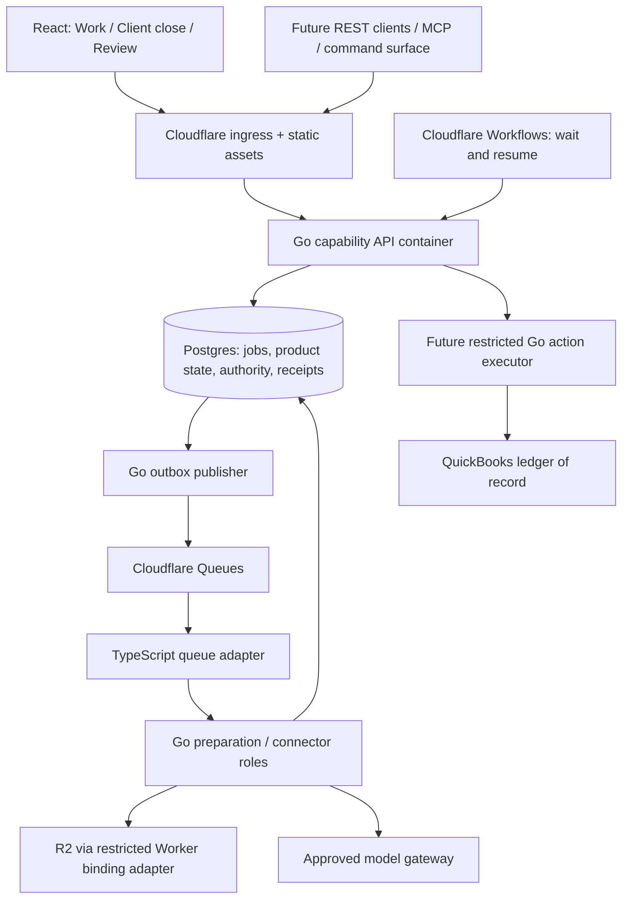

# Architecture and agent contract

## Runtime ownership

The diagram is the destination; the current running path is React → ingress/native proxy → Go reference reads or synchronous prepaid draft preparation. Postgres is local infrastructure only. The queue adapter exists but has no subscribed queue and the Go worker refuses handoff. No Workflow, R2 bucket, model or external ledger is provisioned.

## Boundaries that scale

- `apps/frontend` owns interaction, navigation, presentation and accessible states. No authoritative amount calculation, permissions or job state in React. Keep feature components near their feature; extract shared UI only when reused.
- `services/backend` is one Go module. Its independently runnable API and worker share domain code. Add `internal/evidence`, `internal/workpapers`, `internal/procedures`, `internal/jobs`, `internal/connectors`, and `internal/actions` with their first real behavior, not empty interfaces now.
- `workers/edge` serves assets and routes public capability requests. It must not forward arbitrary URLs or expose `/internal` handlers. The reference endpoint returns synthetic data; prepaid preparation computes a transient draft from supplied inputs without saving or logging the body. No authenticated customer-data workspace exists yet.
- `workers/queue` is delivery transport. Message bodies are job references, not arbitrary model instructions or ledger operations. The future Go handler validates schema and looks up current job authority in Postgres.
- `workers/workflows` will own bounded waits, retries and signals. It does not calculate balances or approve actions. Durable step output stores identifiers, not large documents.
- `packages/contracts` is the cross-runtime contract boundary. Add OpenAPI and generated clients with the first live endpoint. The reference type is small and handwritten; do not build a generator for one fixture.
- `infra/postgres/migrations` owns ordered SQL migrations when persistence ships. Migration execution is a separate delivery action, never an implicit side effect of starting every replica.

Cloudflare Containers run Go as Linux processes; TypeScript Workers adapt bindings. Use a restricted outbound handler for R2/Queues access from Go, not an imagined Go binding SDK. Cloudflare local container development requires Docker. [Containers guide](https://developers.cloudflare.com/containers/get-started/), [local development](https://developers.cloudflare.com/containers/guides/local-dev/).

## Agent-first means one capability path

For each real capability define: typed input/output, required entity scope, allowed operating mode, evidence prerequisites, determinism/side effects, cancellation boundary and explicit error codes. Browser controls, natural language and MCP call the same Go application function. The model may propose the next permitted capability; code authorizes and executes it.

A persisted job needs: stable ID, firm/entity/period, goal and supported scope, requesting actor, source/procedure versions, allowed capabilities, budget, attempt/checkpoint history, cancel request, and explicit terminal/blocker state. Re-check authority when resuming; a previously valid job is not a permanent credential.

Use separate state axes:

| Object | State vocabulary to preserve |
| --- | --- |
| Job | queued, running, waiting on evidence/review, cancelled, failed, completed |
| Workpaper | draft, prepared, reviewed, stale |
| Proposal | prepared, approved, rejected, superseded |
| Action | intended, executing, execution unknown, posted, verified, failed |
| Close | preparation readiness, unresolved scope and firm sign-off recorded separately |

The specific transitions ship with the behavior and tests. No job state can imply verified posting or sign-off.

## Durability and authority

1. Authenticate actor; authorize firm, entity and period. Derive scope from trusted identity plus authorized request data, never a forwarded user-controlled header alone.
2. Write job and outbox record in one Postgres transaction. Publisher delivers a stable operation ID. Reconcile publish-before-mark crashes.
3. Consumer validates the delivery and durably records a tenant-scoped inbox/lease. Duplicate deliveries resolve to the same operation. Only then return the handoff acknowledgement.
4. Worker records reproducible step outputs and dependencies. A retry reuses the durable operation, not a fresh external effect. Cancellation stops future work but cannot erase completed effects.
5. Approvals bind exact proposal hash, source/procedure revisions, actor, firm/entity/period, target, operation, accounts, amounts and expiry. Recheck current authority immediately before execution.
6. Executor persists intent/attempt before calling the provider, then independently reads back. Lost responses stay unknown until reconciled. A compensating entry is a new approved action.

Before activating queues, implement a transactional inbox/outbox, bounded retry/dead-letter policy, replay check, lease expiry and observation of parked/unknown work. No general retry helper should retry ledger writes.

## Data and money

Postgres owns application state, never the source ledger. Use tenant-bearing composite foreign keys and enforced authorization on every relation. Add row-level security as defense in depth with non-owner application roles; test cross-tenant denial before live intake. Persist original evidence revisions and content hashes, extracted source locations, dependencies and approvals as distinct records. Use private object storage keys scoped to authorized entities; do not treat guessed key names as access control.

Amounts cross JSON boundaries as decimal strings with currency. Use reviewed exact integer minor-unit or decimal arithmetic in Go and `numeric` in Postgres, never JS floats for authoritative calculations. The reference fixture transports strings; prepaid preparation validates decimal strings and calculates with bounded int64 cents. Preserve accounting dates separately from UTC timestamps and source observation/event times.

## Model and tool boundary

No provider is selected or SDK installed. The TypeSafe skill and live building guide were read; no repository `.env` key exists, so no Jev advisory call was made. Its applicable principle is to keep known rules and execution in code and use bounded structured judgments for semantic work. [TypeSafe building guide](https://docs.typesafe.ai/concepts/how-to-build-with-system-one)

Future model calls receive minimum authorized evidence, citation identifiers, approved methods, and permitted tools. They never receive OAuth refresh tokens or direct posting credentials. Treat files, mail, ledger memos and MCP results as data. Valid JSON and model confidence are not proof of accounting correctness, completeness or authority.

Track job/step IDs, source freshness, blocker reasons, latency and cost; omit financial content from operational logs. Measure total human effort and re-review burden, not number of agent actions.

## Public SPA and product boundary

The public marketing layout serves `/`, `/contact`, and `/login`; it has no product-data fetch. `/dashboard`, `/dashboard/close`, and `/dashboard/review` load the product feature separately. React Router owns URL matching and navigation. Contact details remain unset by request; login is a truthful pre-authentication landing page, not a mock session.

`VITE_API_BASE_URL` selects an independently hosted backend at frontend build time; empty means same-origin routing. Go's `FRONTEND_ORIGIN` permits one exact cross-origin browser origin (GET and the prepaid JSON POST preflight) and varies the response on Origin. CORS does not authorize an actor or protect the public synthetic reference. Real customer dashboard/API access still requires server-side identity and per-entity authorization before activation.

The first deterministic tool is `prepaids.Prepare`: input terms and explicit confirmations → calculated schedule and draft proposal. Its HTTP adapter is `POST /v1/workpapers:prepare`. It completes synchronously and has no external effect, so adding a durable coordinator to this arithmetic would not improve recovery. Durability becomes required when evidence retrieval, persisted close work or external actions are implemented. Neither this response nor its confirmation flags grants posting authority.

## Current saved-close slice

Client/month closes and immutable calculated snapshots now live in PostgreSQL. The same synchronous domain functions serve UI and agent API callers. Saved routes require a single-workspace bearer token; this development boundary does not establish multi-firm identity. WorkOS AuthKit is the likely hosted identity provider. See `saved-closes-and-reconciliation.md` for the implemented scope and exclusions.
