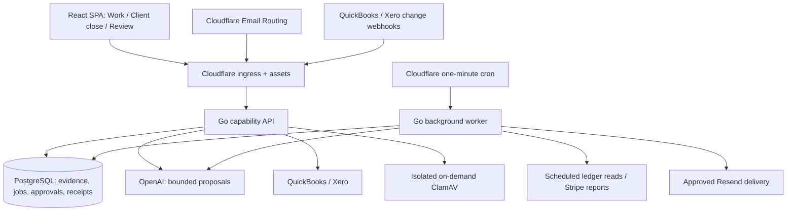

# Architecture and agent contract

## Running system

This is the implemented path, not the original target diagram. Go owns accounting and authorization. PostgreSQL owns durable state and currently stores original evidence bytes and extracted text. The connected accounting provider remains the ledger of record. There is no deployed R2 bucket, Cloudflare Queue subscription or Workflow. Their directories are boundaries for possible later adapters, not required infrastructure for today's preparation jobs.

`cmd/api` serves capabilities; `cmd/worker` runs preparation/extraction, approved email delivery, forwarded intake, QuickBooks sync, Xero refresh, Stripe reports, alerts, standing approvals, schedule comparisons, replays and [workflow runs](workflow-engine.md). A cron wakes the worker container once a minute; its internal loops poll PostgreSQL. This normally keeps the worker and database active. Leases, checkpoints and receipts survive container loss; a running process alone is not evidence of completion.

## Repository ownership

| Path | Responsibility |
| --- | --- |
| `apps/frontend` | Marketing, authenticated workspace, review and client request UI; no authoritative money or access decisions |
| `services/backend/internal` | Shared domain calculations, evidence, preparation, auth, provider operations and HTTP/MCP adapters |
| `workers/edge` | SPA assets, API ingress, PDF scan attestation and inbound email routing |
| `workers/queue` | Cron-woken Go worker container; queue adapter is unbound |
| `services/scanner`, `workers/scanner` | Separate ClamAV image and authenticated on-demand ingress; no database/model credentials |
| `workers/workflows` | Reserved boundary; no deployed workflow |
| `infra/postgres/migrations` | Ordered schema changes, applied separately from hosted startup |
| `packages/contracts` | Existing shared shapes; no generated whole-API contract is implied |

Cloudflare containers run portable Linux binaries, with TypeScript adapting Cloudflare bindings. Compose starts the same Go image locally. API and worker use the same reviewed revision and database schema. There is one configured container per role today; measure load before expanding it.

## Identity and authority

A WorkOS organization represents an accounting firm. A client is a case-insensitive client label inside that firm; a close adds a period. Hosted calls require a verified session, active recorded firm membership, action permissions and either firm-wide access or a client assignment. The local token is a shared development identity, not a multi-firm test.

PostgreSQL row-level security checks `app.organization` using a non-owner runtime role. The connection wrapper sets session state: use a **direct/session-preserving database connection**, not a transaction pooler. System routes and the background worker intentionally access multiple firms and retain application-level scope/authority checks. See [operations](operations.md#row-level-security).

Agents propose facts, questions, scope and supported work. Deterministic Go functions calculate amounts. People approve accounting treatments, posting, email and sign-off. Browser, natural-language and MCP surfaces reuse existing capabilities; model text cannot grant authority. Evidence, intake jobs, close preparations, request drafts and approval requests an agent makes under a member's MCP agent access stay the member's and also record the MCP client's ID when the token carries one, otherwise an unverified MCP marker. See [MCP deployment boundary](mcp.md#deployment-boundary).

## Durable work and external effects

- Evidence, source revisions, procedure versions, reviews and posting attempts retain their identities and history. Replacement invalidates dependent work; copying a new file is not proof that it supersedes another.
- Preparation uses persisted jobs, fenced extraction/model claims, checkpoints and current-source checks. Known deterministic calculations do not need a second queue or model call.
- Client replies and released attachments resume the affected durable work. Receipt, malware scan, firm release and accounting confirmation are distinct states.
- Ledger writes persist an attempt before the external call. Approvals bind current evidence, proposal, company, accounts and authority. Unknown outcomes remain blocked for reconciliation; no generic retry creates another write.
- Approved email has its own durable outbox and bounded provider-specific retries. A delivered email does not establish that its recipient read or answered it. A firm's reminder rule bounds reminders; each is still approved individually.
- Signed QuickBooks and Xero webhooks only record change hints; the scheduled reads decide what to capture again. A hint is not proof that a capture is complete.
- Close sign-off covers a defined scope. Prepared, reviewed, posted, verified and signed off are different outcomes.

## Data, money and models

Amounts use exact Go arithmetic and PostgreSQL numeric values; decimal strings cross JSON boundaries. Currency, accounting dates and observed provider versions are explicit. Each supported treatment has exclusions and accountant approval requirements: [accounting methods](accounting-methods.md).

Original evidence remains in PostgreSQL under the current bounded storage limits, not R2. TXT/CSV and PDF/OCR are supported; direct staff evidence intake differs from quarantined client or forwarded intake. See [evidence](evidence-and-preparation.md) and [scanning](cloudflare-upload-scanning.md).

OpenAI is configured on API and worker: the worker interprets evidence, while API features include command/procedure drafting. Without provider settings, local proposals remain explicitly limited. Requests use bounded authorized text and structured outputs; documents and replies are untrusted data. OAuth secrets are not model context. `store: false` is not a claim about all provider retention obligations.

Operational logs and alerts omit document contents. Model-call limits are not dollar caps. Recovery must restore the matching encryption key and reconcile external outcomes before workers resume. See [deployment](deployment.md), [operations](operations.md) and [the acceptance matrix](onboarding.md#staging-acceptance-matrix).
